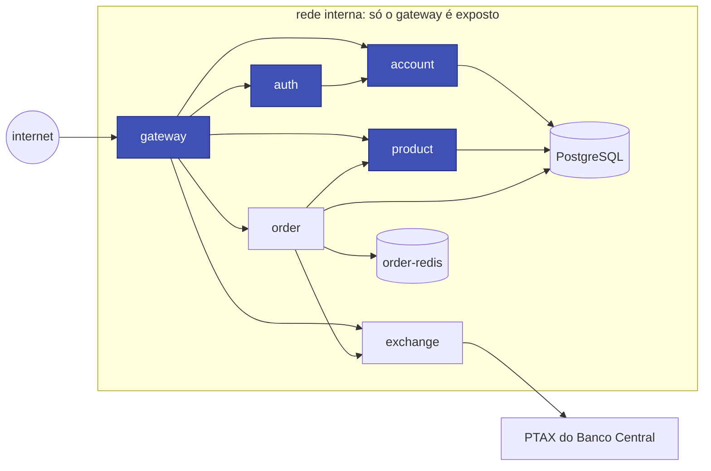
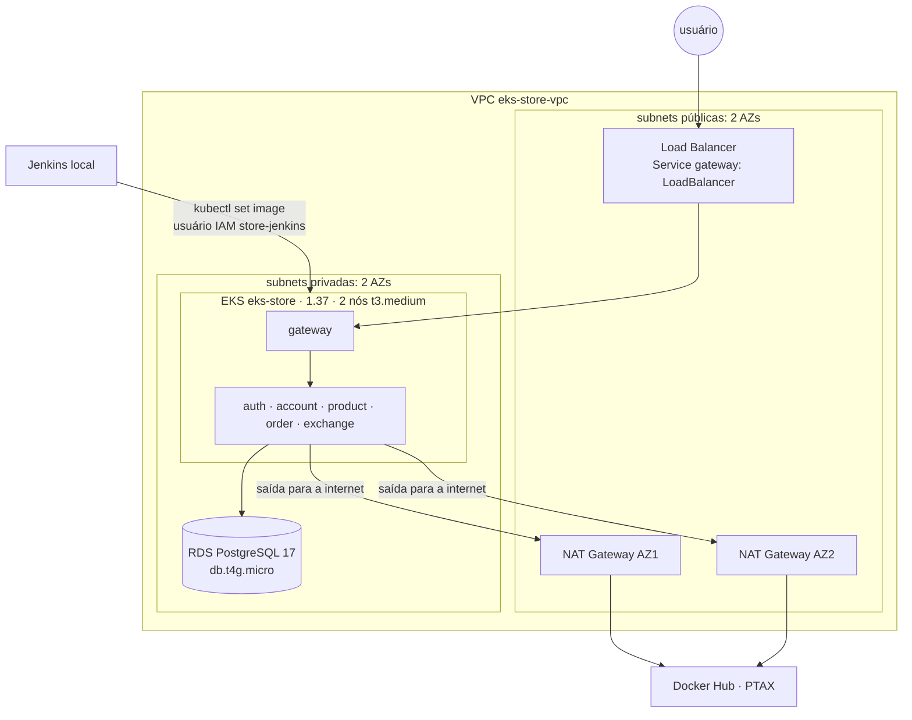

# Arquitetura

## Serviços



Em azul, os serviços implementados por Pedro Machado.

| Serviço | Dono | Linguagem | Banco | Chama |
|---|---|---|---|---|
| **gateway** | **Pedro Machado** | Java (Spring Cloud Gateway) | — | auth (`/auth/solve`) e roteia o resto |
| **auth** | **Pedro Machado** | Java | — | account |
| **account** | **Pedro Machado** | Java | schema `accounts` | — |
| **product** | **Pedro Machado** | Java | schema `products` | — |
| order | Enzo | Java | schema `orders` + Redis | product, exchange |
| exchange | Pedro Garcia | Python (FastAPI) | — | PTAX (API externa) |

Regras que todos seguem (combinadas no documento de passagem que Pedro Machado escreveu para o grupo):

- nome do Service no Kubernetes (e no compose) igual ao do serviço, sempre na porta **8080**;
- `GET /<serviço>/health-check` responde 200 sem login;
- identidade só pelos headers `id-account`/`id-role` vindos do gateway;
- segredos (chave do JWT, seed do admin, senha do banco) só em `.env` local ou Secret do
  Kubernetes, **nunca no Git** (os repositórios têm só `.env.example`).

## Repositório root e submódulos

```text
store-pma/
├── api/
│   ├── compose.yaml          # db + account + auth + product + order + gateway (só o gateway publica 8080)
│   ├── .env.example          # JWT_SECRET_KEY, ACCOUNT_ADMIN_EMAIL, ACCOUNT_ADMIN_HASH (sem valores)
│   ├── build.ps1 / build.sh  # mvn install nos contratos, mvn package nos services
│   ├── postgres/             # banco do Minikube (configmap, secret de dev, deployment, service)
│   ├── account/  account-service/  auth-service/  gateway-service/
│   ├── product/  product-service/  order/  order-service/      # submódulos
├── aws/                      # CloudFormation + up.ps1 / down.ps1 + evidências
├── jenkins/                  # compose do Jenkins (modelo do professor)
└── load-test/                # Locust + HPA do gateway
```

Regra seguida sempre: **push no repositório do serviço antes** de atualizar o ponteiro do
submódulo no root, para um `git clone --recurse-submodules` nunca apontar para um commit que não
existe no GitHub.

## Na AWS

Tudo em **us-east-2 (Ohio)**, criado por CloudFormation (`aws/*.yaml`) a partir do script
`aws/up.ps1`, com a tag `project=store-pma`. Detalhes em [AWS e EKS](aws-eks.md).



- Nós e RDS nas **subnets privadas**: só o Load Balancer tem endereço público. O RDS só aceita
  conexões vindas do security group do cluster.
- Os pods saem para a internet pelos NAT Gateways (é por eles que os nós baixam as imagens do
  Docker Hub).
- O Jenkins não é administrador: o usuário IAM `store-jenkins` só descreve o cluster e edita o
  namespace `default`.
