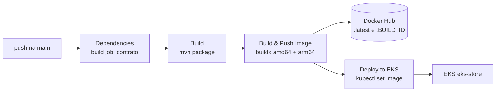

# CI/CD (Jenkins)

Páginas da disciplina: [CI/CD](https://insper.github.io/platform/2026.2/exercises/project/ci-cd/)
e exercício [Jenkins](https://insper.github.io/platform/2026.2/exercises/jenkins/). O requisito:
*"after the image is pushed to Docker Hub, Jenkins deploys the image to EKS"*.

O Jenkins roda em Docker no computador de Pedro Machado (`store-pma/jenkins/compose.yaml`, o mesmo do
professor), com JDK 25, Maven, Docker CLI + buildx, `kubectl` e AWS CLI. Um job **Pipeline** por
repositório ("Pipeline script from SCM", branch `*/main`, `Jenkinsfile` na raiz):

| Job | Repositório | Resultado |
|---|---|---|
| `account`, `product` | contratos | `mvn install` (jar usado pelos services) |
| `account-service` | EP-PC/Account-service | imagem `pedrohmm1/account` + deploy |
| `auth-service` | EP-PC/Auth-service | imagem `pedrohmm1/auth` + deploy |
| `product-service` | EP-PC/Product-service | imagem `pedrohmm1/product` + deploy |
| `gateway-service` | EP-PC/Gateway | imagem `pedrohmm1/gateway` + deploy |



## O estágio de deploy

```groovy title="Jenkinsfile (gateway-service)"
stage('Deploy to EKS') {
    steps {
        withCredentials([usernamePassword(credentialsId: 'aws-credential',
                usernameVariable: 'AWS_ACCESS_KEY_ID', passwordVariable: 'AWS_SECRET_ACCESS_KEY')]) {
            sh '''
                export AWS_DEFAULT_REGION=us-east-2
                trap 'rm -f ./kubeconfig' EXIT                                  # (1)!
                if ! out=$(aws eks describe-cluster --name eks-store 2>&1); then
                    if echo "$out" | grep -q ResourceNotFoundException; then
                        echo "Cluster eks-store nao esta de pe: pulando o deploy"; exit 0   # (2)!
                    fi
                    echo "$out"; exit 1
                fi
                aws eks update-kubeconfig --name eks-store --kubeconfig ./kubeconfig
                kubectl --kubeconfig ./kubeconfig set image deployment/${SERVICE} ${SERVICE}=${NAME}:${BUILD_ID}
                kubectl --kubeconfig ./kubeconfig rollout status deployment/${SERVICE} --timeout=300s   # (3)!
            '''
        }
    }
}
```

1. O kubeconfig temporário é apagado mesmo se o deploy falhar: nenhuma credencial fica no
   workspace.
2. O cluster só fica ligado durante os testes (custo). Com ele desligado, o build ainda publica
   a imagem e termina com sucesso; qualquer **outro** erro da AWS falha o build.
3. O build só fica verde se o rollout terminar: imagem que não sobe = build vermelho.

A imagem vai com a tag do número do build (`:2`, `:3`...), não só `latest`: assim o
`set image` sempre muda o Deployment (dispara o rollout) e dá para saber qual build está no ar.

## Credenciais (menor privilégio)

| ID | Tipo | Para quê |
|---|---|---|
| `dockerhub-credential` | usuário + token Read & Write | push das imagens |
| `github-credential` | usuário + token | checkout dos repositórios |
| `aws-credential` | access key do usuário IAM `store-jenkins` | deploy no EKS |

O `store-jenkins` não é administrador: na AWS só pode `eks:DescribeCluster` do `eks-store`; dentro
do cluster tem `AmazonEKSEditPolicy` **só no namespace `default`** (access entry criada pelo
`up.ps1`). Se a chave vazar, ela não cria recursos nem mexe em outros namespaces.

## Evidências

Builds `#2` dos quatro services em 12/11/2026, todos com deploy no EKS:

```text
Checking out Revision c58201197515aa3d846718eae004ab6df7099987 (refs/remotes/origin/main)
#12 pushing manifest for docker.io/pedrohmm1/gateway:2 2.5s done
deployment.apps/gateway image updated
deployment "gateway" successfully rolled out
Finished: SUCCESS
```

```text
NAME      IMAGE                       READINESS
auth      pedrohmm1/auth:2            8080
gateway   pedrohmm1/gateway:2         8080
product   pedrohmm1/product:2         8080
```

Build `#3` do `gateway-service` em 18/11/2026 (health-checks do Order/Exchange): push de
`pedrohmm1/gateway:3` multi-arch; com o cluster desligado, o estágio de deploy pulou sem falhar,
como previsto.

## Deploy sem derrubar a API

Nos primeiros deploys pelo Jenkins, foram medidos ~40 s de HTTP 503 a cada rollout. A correção
(`readinessProbe`) está em [Bottlenecks](bottlenecks.md#2-deploy-derrubando-a-api-readinessprobe).
