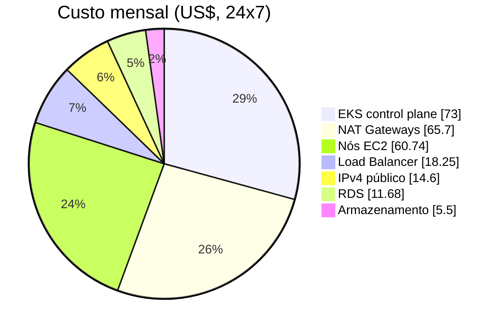

# Custos, PaaS e SLA

Página da disciplina: [Costs & PaaS](https://insper.github.io/platform/2026.2/exercises/project/costs/).
O levantamento de preços foi feito pelo **Pedro Garcia** para o grupo (preços on-demand de
us-east-2 conferidos na AWS Price List em 18/11/2026; versão completa na
[documentação dele](https://garciapp2.github.io/store-pma-docs/projeto/custos/)). Aqui está o
resumo, com o que Pedro Machado acrescenta como quem montou e operou a infraestrutura.

## Recursos e custo por hora

Os recursos são exatamente os que o `aws/up.ps1` cria:

| Recurso | Quantidade | US$/hora | US$/mês (730 h) |
|---|---|---|---|
| EKS control plane | 1 cluster | 0,1000 | 73,00 |
| Nós EC2 `t3.medium` | 2 | 0,0832 | 60,74 |
| NAT Gateway (um por AZ) | 2 | 0,0900 | 65,70 |
| IPv4 público (NAT + Load Balancer) | 4 | 0,0200 | 14,60 |
| Load Balancer (Service `gateway`) | 1 | 0,0250 | 18,25 |
| RDS PostgreSQL `db.t4g.micro`, Single-AZ | 1 | 0,0160 | 11,68 |
| EBS dos nós + armazenamento do RDS | 60 GB | 0,0076 | 5,50 |
| **Total fixo** | | **≈ 0,342** | **≈ 249,50** |

Mais da metade (EKS + NAT, 56%) é infraestrutura fixa que **não depende da carga**: os nós, onde
a aplicação roda de fato, são só 24%.

## Como operamos para gastar pouco

Foi por causa desse custo fixo que o ambiente foi feito **descartável**:

- `up.ps1` sobe tudo em ~30 min; `down.ps1` apaga tudo em ~20 min. O cluster só fica de pé
  durante testes. Uma sessão típica (subir, testar 1 h, derrubar) custa **~US$ 0,70**; o mês
  inteiro ligado custaria ~US$ 250.
- Tudo leva a tag `project=store-pma`, o que permite filtrar o gasto real no Cost Explorer.
- O Jenkins não precisa do cluster ligado: com ele desligado, o pipeline publica a imagem e pula
  o deploy.
- **Incidente real:** em 12/11 o `down.ps1` parou no meio (queda de internet + login expirado) e
  o cluster ficou ligado a noite toda, ~12 h × US$ 0,34 ≈ **US$ 4** jogados fora. O script foi corrigido
  (ver [AWS e EKS](aws-eks.md)) e o inventário passou a ser conferido depois de todo `down.ps1`.

## Como ficaria mais barato

| Mudança | Economia/mês | Custo |
|---|---|---|
| 1 NAT Gateway em vez de 2 | −US$ 36,50 | se a AZ do NAT cair, os pods perdem a saída para a internet |
| Nós Graviton `t4g.medium` | −US$ 11,68 | nenhum: o Jenkins já publica as imagens para `amd64` **e** `arm64` |
| Nós Spot | 50–70% dos nós | o nó pode ser retomado pela AWS com 2 min de aviso |

A segunda é "de graça" por uma decisão tomada no pipeline: a imagem multi-arch roda em nós ARM
sem nenhuma mudança.

## PaaS

| Peça | Hoje | Modelo |
|---|---|---|
| Banco | RDS (backup, patch e failover são da AWS) | **PaaS** |
| Orquestração | EKS: a AWS opera o control plane; nós, manifestos e deploy ficam com o grupo | CaaS (Kubernetes gerenciado) |
| Imagens | Docker Hub público | SaaS |
| CI/CD | Jenkins em Docker no PC de Pedro Machado | self-hosted |

Para 6 serviços pequenos, um PaaS de verdade (App Runner ou ECS Fargate) seria mais barato e mais
simples de operar. O EKS se justifica pelo objetivo da disciplina (Kubernetes, HPA, probes,
deploy contínuo) e pela **portabilidade**: os mesmos `k8s.yaml` rodaram no Minikube e no EKS sem
mudança.

## SLA

Serviços usados em série (se um cair, a aplicação cai):

| Serviço | SLA mensal |
|---|---|
| Amazon EKS | 99,95% |
| Amazon EC2 (nós em 2 AZs) | 99,99% |
| Elastic Load Balancing | 99,99% |
| Amazon RDS Single-AZ | **99,5%** |

$$
0{,}9995 \times 0{,}9999 \times 0{,}9999 \times 0{,}995 \approx 99{,}43\%
$$

Até **~4 h fora do ar por mês**, e o elo fraco é o RDS Single-AZ (Multi-AZ levaria a ~99,88%).

Riscos que o SLA da AWS não cobre, na parte de Pedro Machado:

- **réplica única** em account, auth e product: se o nó cair, o pod é recriado no outro nó com
  ~40 s de inicialização do Spring. Só o gateway escala (HPA);
- **deploy:** coberto pela `readinessProbe` (no máximo 1 requisição perdida por rollout);
- **Auth é dependência de tudo:** se o Auth cair, toda rota protegida responde 503 no gateway
  (a vitrine pública continua no ar). Duas réplicas do Auth seriam o primeiro passo para 99,9%.
