# Teste de carga e HPA

Página da disciplina: [Load Testing](https://insper.github.io/platform/2026.2/exercises/project/load-testing/).
Arquivos em `store-pma/load-test/`: `locustfile.py`, `hpa-gateway.yaml`, `requirements.txt` e o
README com os resultados. Pedro Machado planejou, rodou e mediu este teste no EKS em 12/11/2026.

## Cenário

**Locust** (`locust==2.46.7`) com dois perfis, como o uso real da loja:

```python title="locustfile.py (trecho)"
class Visitante(HttpUser):          # 3 de cada 4 usuários: só navega na vitrine
    weight = 3
    wait_time = between(0.5, 1.5)

    @task
    def vitrine(self):
        self.client.get("/products", name="GET /products (anonimo)")


class Cliente(HttpUser):            # 1 de cada 4: cadastra, faz login e usa rotas autenticadas
    weight = 1
    wait_time = between(0.5, 1.5)

    def on_start(self):
        email = f"loadtest.{uuid.uuid4().hex[:12]}@teste.local"   # conta descartável, nunca o admin
        self.client.post("/auth/register", json={...})
        self.client.post("/auth/login", json={...})               # cookie fica na sessão

    @task(3)
    def vitrine(self):
        self.client.get("/products", name="GET /products (logado)")

    @task(2)
    def perfil(self):
        self.client.get("/auth/me", name="GET /auth/me")          # gateway -> /auth/solve -> account
```

O `GET /auth/me` é o **caminho mais caro** do sistema: o gateway valida o cookie no Auth, e o Auth
consulta o Account, que consulta o RDS.

**HPA do gateway** (equivale ao `kubectl autoscale` da página, mas versionado):

```yaml title="hpa-gateway.yaml"
apiVersion: autoscaling/v2
kind: HorizontalPodAutoscaler
metadata:
  name: gateway
spec:
  scaleTargetRef:
    apiVersion: apps/v1
    kind: Deployment
    name: gateway
  minReplicas: 1
  maxReplicas: 6          # (1)!
  metrics:
    - type: Resource
      resource:
        name: cpu
        target:
          type: Utilization
          averageUtilization: 50   # (2)!
```

1. 6, e não 10: o cluster tem 2 nós `t3.medium` (4 vCPU) e não tem Cluster Autoscaler; réplicas
   além do que cabe ficariam `Pending`.
2. 50% do **request** de CPU do gateway (250m), ou seja ~125m por pod. Precisa do
   **metrics-server**, instalado como add-on do EKS no `eks.yaml`.

Ambiente: EKS us-east-2, 2 nós `t3.medium`, RDS `db.t4g.micro`. O gerador rodou no PC de Pedro Machado, no
Brasil (1 master + 4 workers do Locust, porque `--processes` não funciona no Windows).

## Resultados (12/11/2026)

A rede Brasil → Ohio sozinha custa ~160–230 ms por ida e volta, então o **p50 (~170 ms) é quase
todo rede**. O que a carga afeta é a **cauda** (p95/p99).

| Cenário | Usuários | req/s | Falhas | p50 | p95 | p99 | CPU máx. do gateway |
|---|---|---|---|---|---|---|---|
| Referência, sem HPA | 100 | 77,5 | 0 | 170 ms | 260 ms | 440 ms | 470m[^jit] |
| Estresse, sem HPA | 300 | 235 | 0 | 170 ms | 220 ms | 330 ms | 296m |
| **Estresse, sem HPA** | **800** | **566** | **0** | **180 ms** | **770 ms** | **1.400 ms** | **493m / 500m (teto)** |
| **Estresse, com HPA** | **800** | **597** | **0** | **170 ms** | **320 ms** | **910 ms** | dividida em 4 pods |

[^jit]: Aquecimento da JVM (JIT) nos primeiros minutos depois do deploy; com a JVM quente, 300
    usuários gastaram menos CPU que 100.

Com 800 usuários, o HPA escalou o gateway de **1 → 2 → 4 réplicas em ~40 s** (eventos
`SuccessfulRescale`) e ficou estável em 4. O **p95 caiu 58%** (770 → 320 ms) e o **p99 35%**
(1.400 → 910 ms), sem nenhuma falha.

```mermaid
xychart-beta
    title "800 usuários: latência (ms)"
    x-axis ["p50", "p95", "p99"]
    y-axis "ms" 0 --> 1500
    bar [180, 770, 1400]
    bar [170, 320, 910]
```



<small>Barras da esquerda: sem HPA; da direita: com HPA.</small>

## O que os números mostram

1. **Gargalo: CPU do gateway.** Ele é a porta de toda requisição e, nas autenticadas, ainda chama
   o `/auth/solve`. Com 800 usuários bateu o limite do `k8s.yaml` (500m), o Kubernetes
   estrangulou a CPU (*throttling*) e as requisições fizeram fila. Corrigido com o HPA
   (ver [Bottlenecks](bottlenecks.md)).
2. **Folga nos outros serviços** com 800 usuários: product ~310m, account ~300m, auth ~110m (de
   500m). Os próximos a saturar seriam product e account, que consultam o RDS.
3. **Limite do cluster:** sem Cluster Autoscaler, o máximo é o que cabe em 2 nós. Para crescer
   além disso: Cluster Autoscaler ou Karpenter.
4. **Limitação do teste:** a tabela de produtos estava vazia (respostas pequenas); com catálogo
   real, product e RDS pesariam mais.

As 500 contas `loadtest.*` criadas pelo teste foram apagadas do RDS no fim.

## Vídeo do teste com HPA

O vídeo foi gravado pelo Pedro Garcia para o grupo, com os **mesmos `k8s.yaml` e o mesmo
`hpa-gateway.yaml`** que Pedro Machado fez para o EKS, num cluster kind de 2 nós:

<video controls preload="metadata" width="100%">
  <source src="../../video/hpa.mp4" type="video/mp4">
  Seu navegador não toca vídeo: <a href="../../video/hpa.mp4">baixe o arquivo</a>.
</video>

- **em cima:** geradores de carga chamando `GET /products` em loop;
- **embaixo à esquerda:** `kubectl get hpa gateway -w`: a CPU sobe acima do alvo e o HPA vai de
  **1 para 4 réplicas**;
- **embaixo à direita:** os pods do gateway nascendo e a CPU de cada um (`kubectl top`).

Os números da tabela acima são os do Locust no EKS.
